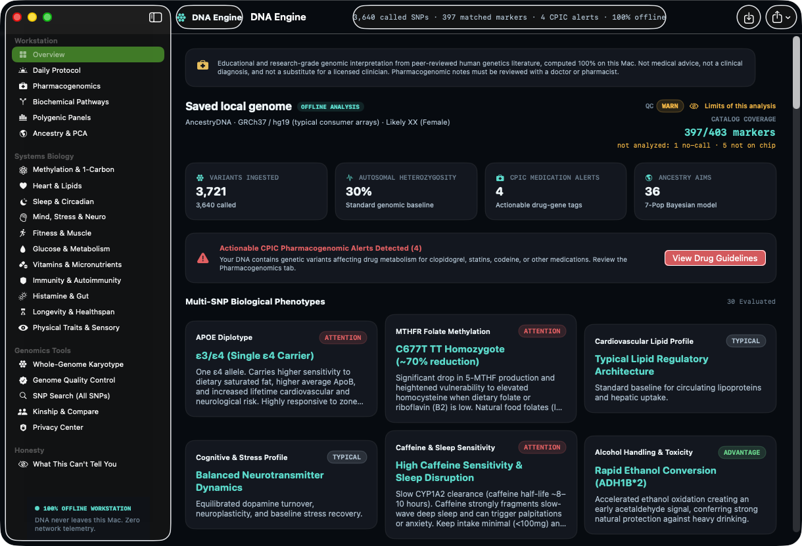
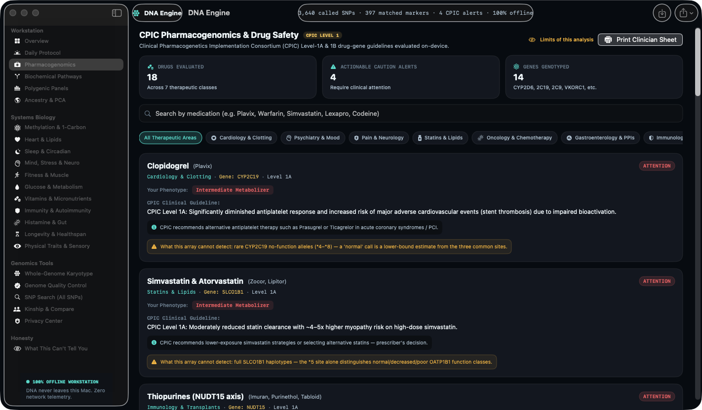
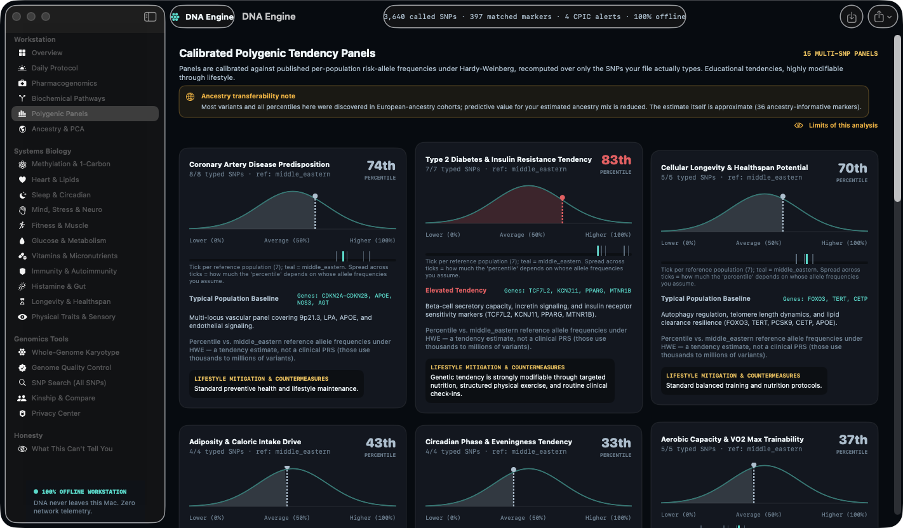
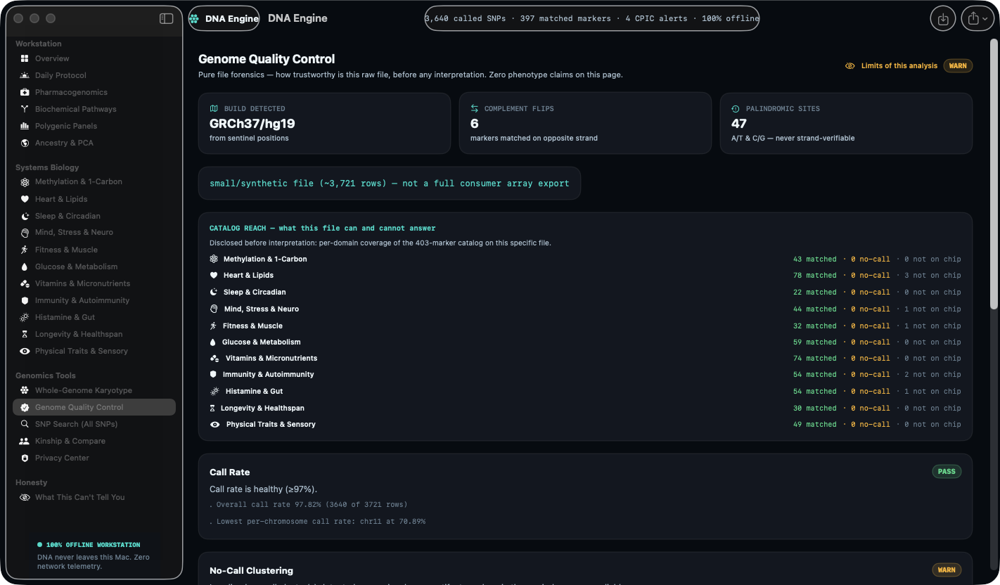
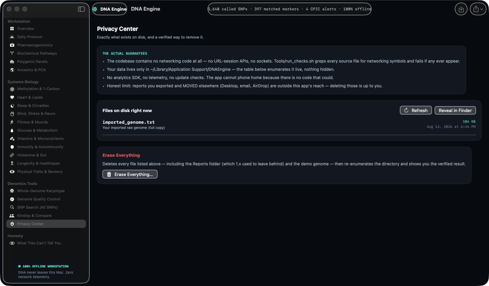

# DNA Engine

**A 100% offline, bring-your-own-DNA genomics workbench for macOS.**

DNA Engine is a native SwiftUI application that reads *your* consumer raw-DNA export or VCF entirely on *your own* Mac and turns it into a curated, citation-backed research readout: a 403-marker interpretation catalog across ~15 biological domains, local ancestry against a bundled 2,621-marker reference panel, a conservative pharmacogenomics surface, polygenic-tendency panels, runs-of-homozygosity, genome quality control, and a two-file raw-concordance comparison — with an encrypted local workspace and a hard, explicit refusal to overclaim.

There is **no cloud, no account, no telemetry, no analytics, no updater, and no network code**. Your genome never leaves your machine.

> ⚠️ **Research and educational use only.** DNA Engine is **not** a medical device, a diagnostic assay, a clinical pharmacogenomics test, an ancestry-identity/nationality service, or a validated relationship/kinship test. It does not diagnose, treat, prescribe, or recommend a diet, supplement, medication, dose, training plan, or clinical action. Discuss anything health-related with a licensed clinician. See **[The Science Contract](#the-science-contract)**.

---

## Table of contents

- [Who it's for](#who-its-for)
- [Screenshots](#screenshots)
- [Feature tour](#feature-tour)
- [The Science Contract](#the-science-contract) — what it will and won't claim
- [Privacy & data model](#privacy--data-model)
- [Architecture overview](#architecture-overview)
- [Build from source](#build-from-source)
- [Usage](#usage)
- [The interpretation catalog & knowledge pipeline](#the-interpretation-catalog--knowledge-pipeline)
- [The ancestry reference panel](#the-ancestry-reference-panel)
- [Test & verification harness](#test--verification-harness)
- [Contributing](#contributing)
- [License](#license)
- [Acknowledgements & data sources](#acknowledgements--data-sources)

---

## Who it's for

- **Curious individuals** who already downloaded their raw data from a consumer testing service and want to explore it privately, offline, without re-uploading it to a third party.
- **Students and educators** in human genetics who want a hands-on, honestly-bounded tool that shows *both* what a SNP array can suggest and — just as importantly — what it cannot.
- **Tinkerers and contributors** who want a well-documented, dependency-light Swift + Python codebase to extend with new markers, panels, or reference data.

DNA Engine is deliberately conservative. If you're looking for a tool that will tell you your "nationality", your metabolizer phenotype, or a supplement to buy, this isn't it — and the [Science Contract](#the-science-contract) explains why.

---

## Screenshots

Screenshots live in [`qa-2.0/`](qa-2.0/). **All screenshots depict the built-in synthetic demo persona — not a real person.**

| | |
|---|---|
|  | **Overview** — saved-genome summary, catalog coverage, multi-SNP phenotype cards |
|  | **Pharmacogenomics** — per-locus observations only (no phenotype calls) |
|  | **Polygenic panels** — coverage-gated tendency panels |
|  | **Genome Quality Control** — pure file forensics before any interpretation |
|  | **Privacy Center** — encrypted workspace, auto-clear, verified erase |

---

## Feature tour

### Import (safe, in-memory, auditable)
- Accepts consumer raw-DNA text (AncestryDNA/23andMe-style TSV/CSV), **VCF**, **gzip**, and **single-file ZIP**.
- Container type is detected from **content signatures**, not the file extension.
- Hardened decompression limits: **256 MiB** input, **768 MiB** expanded output, **200×** max expansion ratio. Gzip stream completion + checksum are verified; ZIP accepts exactly one safe stored/DEFLATE member and validates local/central metadata, bounds, CRC, and termination.
- Encrypted, ZIP64, multi-disk, multi-entry, path-traversal, special-file, corrupt, concatenated, or over-limit archives **fail closed**. Archive members are decoded in memory — never extracted to a filesystem path.
- Every successful import produces a visible **receipt**: original name/extension, detected container and format, byte counts, archive validation, selected VCF sample, notices, and reconciled accepted/rejected record counts.
- VCF parsing locates `GT` via the `FORMAT` column (not assumed first), handles phased/unphased diploid SNP calls and explicit no-calls, and **refuses** to coerce haploid/polyploid calls, indels, multiallelic rows, non-passing filters, malformed rows, duplicates, or conflicts into plausible-looking genotypes.

### Interpretation catalog (403 markers)
Curated marker definitions across methylation & 1-carbon, heart & lipids, sleep & circadian, mind/stress/neuro, fitness & muscle, glucose & metabolism, vitamins & micronutrients, immunity & autoimmunity, histamine & gut, longevity & healthspan, and physical traits & sensory. Each definition carries an evidence tier, effect text, cross-ancestry transferability label, expected-chip metadata, and at least one non-empty citation pointer. Multi-SNP "compound" phenotypes (e.g. APOE diplotype, MTHFR methylation) are assembled from typed loci only.

### Ancestry & PCA
Two-tier supervised maximum-likelihood admixture against a bundled **2,621-marker** panel (see [The ancestry reference panel](#the-ancestry-reference-panel)). Palindromic sites drop, marker usage is disclosed as "N of 2,621", minimum-marker and minimum-European-share floors produce explicit **refusal states**, and seeded marker-bootstrap intervals accompany every estimate. A legacy 36-AIM 7-population sketch remains visible and is clearly labeled as legacy.

### Pharmacogenomics (observations, not phenotypes)
A 14-gene PGx catalog reports **only** per-locus status — observed / missing / no-call / strand-unresolved / allele-mismatch — plus published drug–gene source pairs. It deliberately does **not** call star alleles, diplotypes, metabolizer phenotypes, medication response, alert severity, doses, or actions. CNVs, structural variants, repeats, HLA alleles, and phase are explicit stated limitations.

### QC, panels, ROH, comparison, honesty
- **Genome QC:** build detection via position sentinels, call rate, no-call clustering, chip fingerprinting, strand status, sex-chromosome signal, per-domain catalog reach.
- **Polygenic tendency panels:** 15 small research panels over typed markers; percentile is **withheld below 60% coverage**. These are explicitly *not* clinical PRS.
- **Runs of homozygosity:** F_ROH over the observed typed span with 3–8 / 8–16 / >16 Mb descriptive classes.
- **Compare (two files):** raw autosomal genotype concordance and allele overlap **only** — no IBD, kinship coefficient, identity, or relationship classification.
- **Honesty surface:** 17 curated limitations merged with file-specific missingness and QC caveats; the limitations appendix is unconditional in full exports.

### Reports
Export to **Markdown, HTML, JSON, PDF**, or a PGx research brief. Filenames carry a millisecond timestamp + random suffix (no same-day overwrite). PDF rendering uses a **nonpersistent** `WKWebsiteDataStore`, disables JavaScript, permits only the local `about:` document, blocks unexpected navigation, and renders self-contained HTML under a `default-src 'none'` CSP.

---

## The Science Contract

DNA Engine's design philosophy is *fail closed and under-claim*. These are load-bearing rules enforced in code and checked by the test harness:

- **Strand safety:** Direct and reverse-complement matching is allowed only when orientation is resolvable. A/T and C/G **palindromic** sites are reported as *Strand unresolved* and withheld from marker, compound, PGx, and downstream interpretation. The app never guesses orientation from the expected result.
- **PGx is observational:** locus observations and source pairs only — never star alleles, diplotypes, phenotypes, response, dosing, or action.
- **Comparison is concordance only:** shared called autosomal rsIDs, exact-genotype concordance, and allele overlap — never identity, IBD, kinship, or relationship degree. A high or low concordance number is **not** a family-relationship result.
- **Pathways/lifestyle are neutral context:** biological context and research questions — never enzyme-rate, expression, flux, or outcome estimates, and never a selected product, amount, restriction, schedule, or treatment.
- **Ancestry is a reference-panel signal, not identity:** percentages carry uncertainty and refusal states and are framed *not-a-passport*. Subcontinental resolution is disclosed as roughly ±10–15 percentage points at best. Ancestry is never a statement of nationality, ethnicity, religion, or identity.
- **Citations are structurally checked, not adjudicated:** the report's evidence appendix is schema- and count-verified by the harness; it does **not** live-validate that every paper or registry record supports every scientific statement. Human review is still required.

---

## Privacy & data model

**Your genome stays on your Mac. There is no network code in the app.** Confirm it yourself: `grep -rniE 'URLSession|http|socket|Network\.framework' Sources/` returns nothing operational.

Three explicit primary modes:

1. **Encrypted Workspace** — the original imported bytes are sealed in `workspace.dnavault`, an **AES-256-GCM** authenticated container. Its random **256-bit** key is a **non-synchronizing** Keychain item with `kSecAttrAccessibleWhenUnlockedThisDeviceOnly` and `kSecAttrSynchronizable = false`. The workspace directory is mode `0700`; the vault and app-created reports are `0600`.
2. **Memory-Only Private Session** — parse and analyze without ever writing the source to disk. Closing the app, clearing the session, or the inactivity auto-clear drops the parsed genome and report state.
3. **Synthetic Demo** — a deterministic, fictional test persona built entirely in memory (see [demo](#the-synthetic-demo)). It never touches the encrypted workspace.

Additional guarantees:
- **This-device-only by design.** There is no cloud escrow, password recovery, or transfer service. If the Keychain key is lost, the ciphertext is unreadable — intentionally.
- **Auto-clear** defaults to 15 minutes (options: Never / 5 / 15 / 30 / 60). It releases app-held genomic state; it is *not* a claim of forensic RAM zeroization, and it does not delete the encrypted workspace.
- **Verified erase** (Privacy Center → Erase Local DNA Data) cancels active import/compare/PDF work, invalidates stale workspace generations so cancelled tasks can't recreate the vault, clears in-process state, deletes everything under the app-support directory, re-enumerates with explicit survivor/I-O-failure reporting, and deletes the Keychain key **only after** files verify empty. Reports you deliberately copied elsewhere are outside this erase boundary.

### The synthetic demo
The demo genome is generated by a deterministic `SplitMix64` PRNG from a fixed seed ([`Sources/DemoGenome.swift`](Sources/DemoGenome.swift)) and a hand-curated fictional persona table ([`Tools/knowledge_sections/demo_persona.py`](Tools/knowledge_sections/demo_persona.py)). Its header literally reads *"It is not a real person — generated locally."* Use it to explore every screen without loading real DNA.

---

## Architecture overview

DNA Engine is a **source-compiled** macOS app — there is no `.xcodeproj`. [`build.sh`](build.sh) compiles the Swift sources with `swiftc`, generates the icon set, stamps `Info.plist`, code-signs with the hardened runtime, and verifies the bundle. Full internals are in [`ARCHITECTURE.md`](ARCHITECTURE.md).

```
Sources/            SwiftUI views + analysis engines (~40 files)
  App.swift, ContentView.swift        app shell & navigation
  GenomeParser.swift, GenomeImportFoundation.swift   in-memory import + archive safety
  AncestryEstimator.swift, AdmixtureEngine.swift, ReferencePanel.swift   ancestry model
  PharmacogenomicsEngine.swift, PathwaysEngine.swift, PolygenicView.swift, ...
  PrivateVault.swift                  AES-256-GCM vault + Keychain key provider
  QCEngine.swift, ROHScanner.swift, ComparisonEngine.swift, HonestyEngine.swift
  ReportExport.swift, OfflinePDFRenderer.swift        multi-format export
  KnowledgeBase.swift                 loads Resources/knowledge.json
Resources/
  reference_panel.json    2,621-marker ancestry panel (1000G + gnomAD, provenance-stamped)
  knowledge.json          generated interpretation catalog
  Info.plist.in           Info.plist template (VERSION/BUILD_NUMBER substituted at build)
Tools/
  knowledge_sections/*.py     per-domain curation modules (source of truth for content)
  generate_knowledge.py       builds Resources/knowledge.json from the modules
  build_reference_panel.py    packages the ancestry panel from frequency sources
  CheckMain.swift, run_checks.sh          deterministic engine harness
  VaultCheckMain.swift, run_vault_checks.sh   isolated AES-GCM vault harness
  fixtures/               synthetic genome/VCF test fixtures
build.sh                  build + verify + (opt-in) install
```

**Content is generated, not hand-edited JSON.** The interpretation catalog is authored in the Python modules under `Tools/knowledge_sections/` and compiled to `Resources/knowledge.json` by `generate_knowledge.py`. Edit the modules, regenerate, and re-run the checks — never edit the JSON directly.

---

## Build from source

### Requirements
- **macOS 14 (Sonoma) or later**
- **Xcode command-line tools** (`xcode-select --install`) — provides `swiftc`, `codesign`, `sips`, `iconutil`, etc.
- **Python 3** (for the knowledge/panel generators and the check harness)

### Build (never touches `/Applications`)
```bash
VERSION="$(<VERSION)" BUILD_NUMBER="$(<BUILD_NUMBER)" BUILD_ONLY=1 ./build.sh
```
This compiles with **warnings-as-errors**, runs the engine and vault checks, signs with the hardened runtime using an available local Developer ID identity **or an ad-hoc fallback** (no signing certificate is required to build), verifies bundle metadata/resources/architectures/runtime links/signature, and writes a checksum manifest. Output: `build/DNA Engine.app`.

Exactly one of `BUILD_ONLY=1` or `INSTALL=1` must be set.

### Install to /Applications (explicit, opt-in)
```bash
VERSION="$(<VERSION)" BUILD_NUMBER="$(<BUILD_NUMBER)" INSTALL=1 ./build.sh
```
Install mode refuses to run while DNA Engine is open, verifies a staged copy, backs up any existing install, performs an **atomic filesystem swap**, and rolls back if post-swap verification fails. It performs no upload, notarization, or remote action of any kind.

> **First launch:** because a source build is typically ad-hoc-signed (not notarized), Gatekeeper may warn on first open. Right-click the app → **Open**, or clear the quarantine attribute for a local build you trust: `xattr -dr com.apple.quarantine "build/DNA Engine.app"`.

### Regenerating bundled data (optional)
```bash
python3 Tools/generate_knowledge.py       # rebuild Resources/knowledge.json from knowledge_sections/
python3 Tools/build_reference_panel.py     # repackage the ancestry panel (see script for its input)
```

---

## Usage

1. **Get your raw data.** Download the raw-DNA export from your testing service, or obtain a VCF.
2. **Import.** *File → Import into Encrypted Workspace…* (`⌘I`) to save it in the encrypted vault, or *Open Memory-Only Private Session…* (`⇧⌘I`) to analyze without persisting.
3. **Check the receipt.** Open **Genome Quality Control** and read the import receipt and QC first — it tells you how trustworthy the file is *before* any interpretation.
4. **Explore.** Overview, Ancestry & PCA, Pharmacogenomics, the domain panels, Polygenic Panels, Whole-Genome Karyotype (ROH), Kinship & Compare, and the Honesty surface.
5. **Export** a report (Markdown/HTML/JSON/PDF) if you want a copy.
6. **Erase when done.** *Privacy Center → Erase Local DNA Data* for verified deletion.

No real DNA on hand? Load the **Synthetic Demo** to walk every screen safely.

---

## The interpretation catalog & knowledge pipeline

The 403-marker catalog and multi-SNP phenotypes are authored as Python in [`Tools/knowledge_sections/`](Tools/knowledge_sections/) — one module per domain (`cardio.py`, `neuro.py`, `metabolic.py`, `vitamins.py`, `pgx.py`, `pgx_genes.py`, `sleep.py`, `immunity.py`, `histamine_gut.py`, `longevity.py`, `pigmentation.py`, `fitness.py`, `methylation.py`, `compounds.py`, `scores.py`, `substances.py`, `traits_sensory.py`, `limitations.py`, …) plus the fictional `demo_persona.py`. `generate_knowledge.py` compiles them into `Resources/knowledge.json`, which `KnowledgeBase.swift` loads at runtime. A passing schema check proves *structural* completeness (every marker has curation metadata and a citation pointer) — **not** scientific truth. Every content change still needs human review of the generated diff.

---

## The ancestry reference panel

[`Resources/reference_panel.json`](Resources/reference_panel.json) is a provenance-stamped **2,621-marker** panel packaged from public population-frequency data:

- **1000 Genomes phase 3** superpopulations and 26 sub-populations, via Ensembl REST release 116.
- **gnomAD v4** genomes for Ashkenazi Jewish (ASJ), Middle Eastern (MID), and Non-Finnish European (NFE) baselines.

Every value is an **ALT-allele frequency** for the stored `ref`/`alt` pair (nothing is pre-oriented to "derived" or "minor"), and each marker carries a `sources` array plus per-source endpoint/release/fetch-date provenance. The engine ([`AdmixtureEngine.swift`](Sources/AdmixtureEngine.swift), [`AncestryEstimator.swift`](Sources/AncestryEstimator.swift)) fits a binomial mixture over the simplex: **Tier 1** continental (AFR/EUR/EAS/SAS/AMR/MID), then **Tier 2** within-European (NWE/TSI/IBS/FIN/ASJ) fit *jointly* on the European component so Southern-European and ASJ-like signals don't masquerade as one another. The full validation methodology and known-answer checks (SLC24A5, EDAR, Duffy-null, LCT, HERC2) are documented in [`Tools/PANEL_REPORT.md`](Tools/PANEL_REPORT.md).

---

## Test & verification harness

```bash
./Tools/run_checks.sh        # deterministic engine harness
./Tools/run_vault_checks.sh  # isolated AES-GCM vault harness
```

- **Engine harness** covers catalog/panel lints, UI-free macOS-14 compilation, safe archive & VCF fixtures, demo determinism, fail-closed scientific migrations, independent ancestry/HWE recomputation, QC fixtures, report generation, citation recounting, verified erase, and static safety greps.
- **Vault harness** runs only in temporary directories with injected test keys — it verifies AES-GCM nonce uniqueness, authentication-failure behavior, missing/wrong-key handling, restrictive permissions, round-trips, migration safety, generation guards, and erase. **It never reads your real workspace or real Keychain item.**
- **PDF QA is manual** (needs a GUI run loop): open a build, load *only the synthetic demo*, export a PDF, inspect it, then erase the test output.

Test fixtures under `Tools/fixtures/` (`genome_truncated_chr.txt`, `genome_zero_roh.txt`, `parser_multisample.vcf`, …) are entirely **synthetic** (placeholder rsIDs like `rs55000000`, sample names `Alpha`/`Beta`) — no real genotypes.

---

## Contributing

Contributions are welcome — especially new curated markers, additional panels, and reference-data improvements.

- **Content changes:** edit the relevant `Tools/knowledge_sections/*.py` module with full curation metadata (evidence tier, effect text, transferability, expected-chip info, and at least one non-empty citation), then regenerate `Resources/knowledge.json` and re-run **both** check suites. Review every generated diff.
- **Respect the Science Contract.** PRs that make the app call phenotypes, doses, clinical actions, relationship/kinship results, or ancestry-as-identity will be declined. The fail-closed behaviors (strand safety, refusal floors, coverage gates) are features, not bugs.
- **Keep it offline.** No networking, telemetry, analytics, accounts, or auto-update may be added.
- Run `./Tools/run_checks.sh && ./Tools/run_vault_checks.sh` and a `BUILD_ONLY=1 ./build.sh` before opening a PR. Compilation is warnings-as-errors.

Please open an issue to discuss substantial changes first. See `ARCHITECTURE.md` for internals.

---

## License

**Apache-2.0** — see [LICENSE](LICENSE) and [NOTICE](NOTICE). The license's "AS IS, without warranty" clause, together with the research-only banner at the top of this README, governs use. **DNA Engine is provided for research and educational purposes only and is not medical advice.**

---

## Acknowledgements & data sources

- **1000 Genomes Project** phase 3 allele frequencies (via Ensembl REST, release 116).
- **gnomAD v4** genomes (ASJ, MID, NFE, and related keys).
- Marker interpretations reference the primary literature plus the GWAS Catalog, PharmGKB, CPIC, and ClinVar registries; citation pointers ship inside `Resources/knowledge.json`. These upstream datasets carry their own terms — the software license here covers the DNA Engine code, not the underlying population-frequency or literature datasets.

Population-frequency data describes populations, not you. Ancestry output is a statistical signal against reference panels, framed *not-a-passport* — never a statement of who you are.